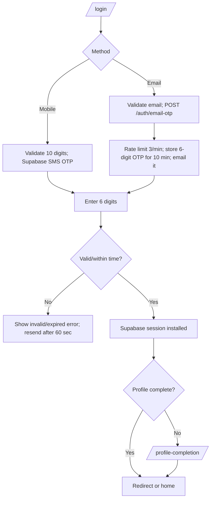
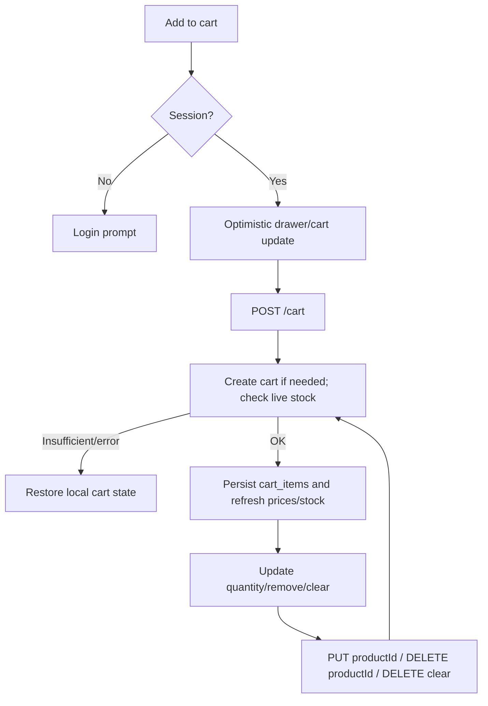
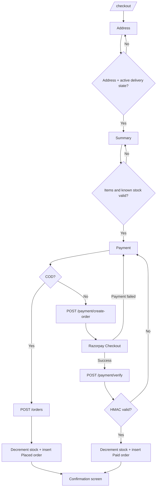
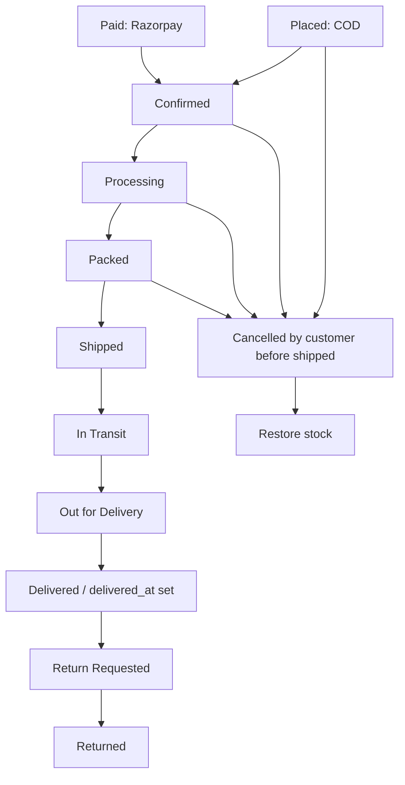
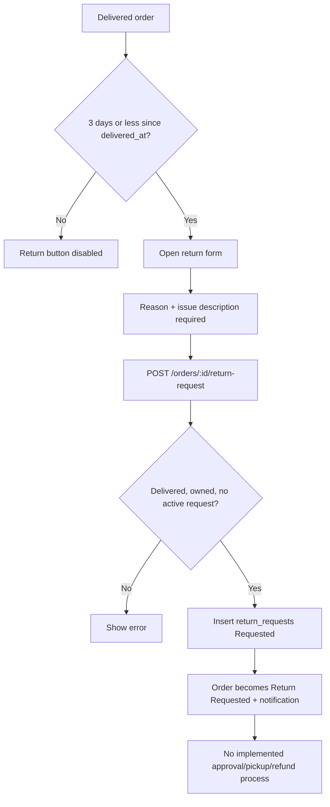
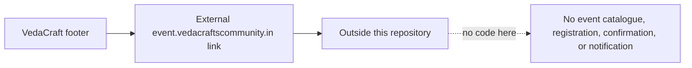

# VedaCraft customer functional flow

## 1. Overview of the customer experience

VedaCraft is a marketplace storefront for handmade, natural and sustainable products. A visitor can explore the home page and catalogue without signing in, choose a delivery location, search, filter category listings, and view product detail pages. The catalogue only exposes active products from active sellers; when a location is selected, it is further limited to sellers serving that city/state.

A customer signs in with a mobile OTP, email OTP, or Google. A first-time user is routed to profile completion before normal storefront pages. Signed-in customers can keep a server-backed cart and wishlist, save addresses, use Buy Now or cart checkout, pay by Cash on Delivery or Razorpay, follow orders, cancel before shipment, request a return after delivery, review delivered orders, and manage an in-app notification feed.

Checkout is a single order containing the current cart items (which may originate from more than one seller). It does **not** split the basket into seller-specific orders or seller-specific shipping charges. On successful COD placement or server-side Razorpay signature verification, the order is persisted in `orders`, stock in `seller_products.stock_quantity` is decremented, and an order-confirmation email is attempted. The order page is the customer’s tracking, cancellation, return, and review surface.

The following describes the implemented behaviour, rather than intended marketplace behaviour. Where screens contain static claims or a backend capability is absent, it is identified in “Gaps / Not implemented”.

## 2. Feature-by-feature breakdown

### 1. Landing / home page

**Purpose.** Discover the marketplace, navigate categories, search products, select a location, open account/cart/wishlist, and begin shopping.

**Screens/pages.** `/`; header and navigation are visible across the customer site. Category links are `/eco`, `/wellness`, `/food`, `/craft`, `/fashion`, and `/decor`.

**Customer actions and system results.**

1. The visitor opens `/`. The page shows the hero banner, Shop by Category cards, then “Best Sellers”, “New Arrivals”, and “Trending” product sections.
2. Home requests `GET /api/v1/products?limit=100` (including selected city/state if set). It displays products 1–10 as Best Sellers, 11–20 as New Arrivals (or 1–10 if fewer), and 21–30 as Trending (or 1–10 if fewer). These labels are display slices, not separately curated backend collections.
3. The visitor uses category cards/navbar, product cards, header search, the location selector, wishlist/cart icons, or account menu. Product cards route to `/product/:id-or-slug`; protected actions prompt login.
4. Location selection is stored locally as `vc_selected_location`; address selection can set it to the selected address’s city/pincode. Product API calls then send city/state and only eligible sellers’ active products are returned.

**Conditions and edge cases.** There is no default automatic geolocation (`AUTO_DETECT_LOCATION = false`). If the product API fails, the three product sections remain empty; there is no home-page error state. Location is a catalogue filter, not a delivery promise.

### 2. Account, profile, and session

**Purpose.** Create/access an account, complete personal details, maintain a session, and sign out.

**Screens/pages.** `/login`, `/profile-completion`, `/profile` (My Profile), `/profile/size-profile`, `/profile/eco-impact`, `/profile/help`; protected profile subpages also include orders, addresses and notifications.

**Customer actions and system results.**

1. On `/login`, choose Mobile or Email. Mobile accepts exactly 10 digits and calls Supabase SMS OTP with `+91`; email validates email syntax then calls `POST /api/v1/auth/email-otp` with `{ email }`.
2. Email OTP generation creates a Supabase magic-link token, keeps a six-digit OTP in the server’s in-memory `emailOtpStore` for 10 minutes, and emails “Your VedaCraft login OTP”. The route allows at most three OTP requests per minute, returning “Too many OTP requests. Please wait a minute before trying again.”
3. Enter six digits. Mobile is verified through Supabase `verifyOtp(... type: 'sms')`. Email calls `POST /api/v1/auth/verify-email-otp`; it checks email/OTP format, expiry, and equality, verifies the stored hash with Supabase, deletes the stored OTP, and returns a session. The browser installs the returned access/refresh token in Supabase and navigates to `redirect` or `/`.
4. Google is available through Supabase OAuth and redirects back to the requested route. New/incomplete profiles are redirected by `ProfileGuard` to `/profile-completion`; completing profile writes `profiles` and marks it complete.
5. The session is restored on application startup. The app validates its access token with Supabase; an invalid/expired session is signed out, removes `vc_user`, clears addresses/cart/wishlist/notifications, and protected operations send the customer back to sign-in.
6. In `/profile`, customers edit personal data and may upload an avatar; `/profile/size-profile` stores apparel preferences/measurements used only to produce a fashion-product size recommendation. Logout calls Supabase sign-out and clears local user/address state.

**Business rules and failures.** Six OTP digits are required. Email OTP failure messages include “Enter a valid email address”, “Enter a valid email and 6-digit OTP”, “OTP expired. Please request a new code.”, and “Invalid OTP”. The resend UI has a 60-second cooldown. Account password signup/login, password change, forgot-password, and reset-password flows do not exist.

### 3. Browsing, search, filters, and sorting

**Purpose.** Find products in a category or by text and narrow the visible result set.

**Screens/pages.** `/search?q=<term>`; `/eco`, `/wellness`, `/food`, `/craft`, `/fashion`, `/decor`; and dynamic `/:category` for database-backed categories.

**Customer actions and system results.**

1. Submit header search to open `/search?q=...`. The page requests the product search/catalog API with `search=<term>&limit=100`; blank query shows no results. Recent-search routes exist but the customer search screen does not call them.
2. Open a category. It calls `GET /api/v1/products/category/:category?limit=100` and maps backend fields to cards.
3. In a category, select subcategories, 10/20/30/40/50/60/80% minimum discount, max price (₹0–₹5,000), and in-stock/out-of-stock availability. These filters run in the browser after the first 100 API products are loaded.
4. Sort by Featured (source order), Price low-to-high, Price high-to-low, or Best rated. Clear all resets the filters. Mobile has a filter drawer.

**System rules.** The API accepts paging (limit maximum 100), `minPrice`, `maxPrice`, `minRating`, `inStock`, `featured`, category/search, city/state, and sort fields `created_at`, `updated_at`, `price`, `name`, `quantity`, or `status`; invalid sort values or invalid/range-reversed numeric filters fail. Only active seller products are catalogued. Category UI filters do not send their filter choices back to the API.

**Edge cases.** Category load failure and zero result both end with empty/no-products UI (the former only logs a warning). Search has a loading view and a no-result state. A selected location can legitimately return no sellers/products.

### 4. Product detail

**Purpose.** Evaluate an item, see its price/stock, seller/reviews/details, and add it to wishlist/cart or Buy Now.

**Screen/page.** `/product/:id`, where the parameter can be the database ID or a product slug.

**Customer actions and system results.**

1. The page loads product, detail, reviews, store information, recently viewed products, and similar catalogue items. Product information comes from `GET /api/v1/products/:id`; optional supplements use `/:id/details`, `/:id/reviews`, and `/:id/store`.
2. Select gallery thumbnails; up to four thumbnail slots are rendered, repeating the first image if fewer exist. Product tabs show description/how-to-use/core instructions; fashion products may show a recommendation based on saved size profile.
3. Review price, MRP/percentage discount and active offer. An active offer reduces the displayed price by its discount amount. “Out of stock” is based on `stock_quantity`/stock `<= 0` and disables Add to Cart and Buy Now.
4. Use heart to toggle wishlist, Add to Cart to add the displayed product/quantity, or Buy Now to navigate to `/checkout` with the one-item router state. Sharing uses the browser sharing/copy mechanism if supported.
5. Read reviews (reviewers are displayed as “Verified customer”) and seller name, trusted-seller label, average rating, rating count, and product count when a seller record is resolvable.

**Rules/edge cases.** Product not found has a Return Home state. Product reviews are public read-only. A product may have no seller details, reviews, images, or supplemental detail record. There is no customer-selectable variant/size/color implementation; the visible size guidance is not a purchasable variant.

### 5. Wishlist and cart

**Purpose.** Save products for later and prepare a purchase basket.

**Screens/pages.** `/wishlist`; cart drawer from the header; `/checkout`.

**Customer actions and system results.**

1. Press a wishlist heart. Sign-in is required; it optimistically updates then calls `POST /api/v1/wishlist` (toggle) or `DELETE /api/v1/wishlist/:id`. The screen calls `GET /api/v1/wishlist` and supports removal/add-to-cart.
2. Add from a card/detail/wishlist. Sign-in is required. UI optimistically increases the existing product’s quantity or adds it, opens cart drawer, and calls `POST /api/v1/cart`.
3. In drawer, increment/decrement/remove items. Quantity cannot fall below one and the client blocks above known stock; updates are debounced 200 ms and call `PUT /api/v1/cart/:productId`. Remove calls `DELETE /api/v1/cart/:productId`; clear uses `DELETE /api/v1/cart/clear`.
4. Server creates a customer `carts` row if needed, stores snapshots in `cart_items`, checks live `seller_products.stock_quantity`, and returns refreshed item details/current prices. It rejects empty IDs, non-integer/non-positive quantity, missing cart item, product-not-found, and insufficient stock (for example “X has only N item(s) in stock”).
5. Checkout from the drawer closes it and goes to `/checkout`.

**Multi-seller behaviour.** The cart does not group items by seller and carries no seller-specific checkout, delivery, tax, or order split. One checkout stores one combined `orders.items` JSON array. This is a functional limitation, not multi-vendor fulfilment logic.

**Failure/session cases.** Failed optimistic cart/wishlist changes are restored; cart quantity refreshes from the server after a failed update. A 401 logs out the session. Cart requests time out client-side after 12 seconds with “Cart is taking too long to load. Please try again.” Empty wishlist/cart has a dedicated empty state.

### 6. Address management

**Purpose.** Maintain delivery addresses and choose one for checkout/location.

**Screens/pages.** `/profile/address`; checkout address step at `/checkout?step=address`; address drawer.

**Customer actions and system results.**

1. Add/Edit an address with full name, phone number, address, city, state, pincode, address type, optional landmark, and optional default setting. All non-optional fields are required by server address API; the application currently performs address persistence directly against Supabase `addresses` in `AuthContext`.
2. On the first address or when marked default, all existing defaults for that user are unset, then the inserted/updated address is `is_default = true`. Addresses are fetched newest first.
3. Delete requires browser confirmation. If selected, checkout switches to another address; otherwise its local location becomes `Tirunelveli - 627002`.
4. On checkout, choose an address, add/edit/delete it, then the selection becomes the local catalogue location and its state is checked with `GET /api/v1/delivery/check-state?state=...`.

**Conditions.** Only signed-in users can manage addresses. If the delivery configuration returns `is_active: false`, checkout cannot continue. There is no address-count limit or pincode-format validation in the shown application code. The REST `/api/v1/addresses` CRUD/default endpoints exist, but the customer UI does not use them.

### 7. Checkout and payment

**Purpose.** Choose a delivery address, review one checkout basket, and pay/submit it.

**Screens/pages.** `/checkout?step=address`, `?step=summary`, `?step=payment`; success state on same route.

**Customer actions and system results.**

1. Enter with cart items, or Buy Now from a product (one routed item). An empty checkout says no items and links home. Buy Now starts at summary if an address exists; otherwise address step.
2. Select/add address. Delivery state is checked. Continue is disabled with no address or inactive delivery state.
3. Review items and change Buy Now quantity. Continue is blocked if basket empty or any known stock is `<= 0`; the client alerts “Out of stock products cannot be purchased.”
4. Choose payment: COD or Razorpay. The displayed total is sum of active sale price × quantity. Price summary labels show free delivery/convenience charge; no shipping fee, tax, coupon or promotion-code calculation is implemented.
5. COD posts the assembled payload to `POST /api/v1/orders`. The backend refreshes product snapshots/prices, decrements inventory, inserts `orders` with status `Placed`, `status_history`, address and items, tries an order-confirmation email, and creates an “Order Placed!” in-app notification.
6. For Razorpay, browser posts `{amount}` to `POST /api/v1/payment/create-order`, loads Razorpay Checkout, and opens it. Its successful handler posts Razorpay payment/order/signature plus order payload to `POST /api/v1/payment/verify`. Server HMAC-verifies `order_id|payment_id`, decrements stock, and inserts `orders` with status `Paid`; it then attempts the same order email. The UI clears cart only after a successful order response and shows Order Placed with links to orders/home.

**Failure/edge cases.** Missing session shows “Please login again to place your order.” Failed order response shows its message or “Failed to place order. Please try again.” Razorpay creation/load/start failures are alerted; Razorpay `payment.failed` shows the gateway error description. A failed payment leaves the cart unchanged; the customer can select payment again and retry manually. Invalid amount returns “Invalid amount”; an invalid HMAC returns “Invalid payment signature”. If Razorpay credentials are absent, the backend returns a mock order and verification skips signature checks for `mock_` order IDs.

### 8. Orders, tracking, and invoice

**Purpose.** See purchases, track their status, cancel eligible orders and access post-delivery actions.

**Screens/pages.** `/profile/orders`; `/profile/orders/:orderId`.

**Customer actions and system results.**

1. My Orders retrieves the customer’s own `orders` from Supabase, newest first (the REST equivalent is `GET /api/v1/orders`). It filters visual lists into On the way (`Placed`, `Paid`, `Shipped`, `In Transit`, `Out for Delivery`), Delivered, Cancelled, and Returned (`Return Requested`). It shows “No orders yet”/“No orders match this filter” as appropriate.
2. Open an order to see address, items, price/payment details, calculated expected date (created date + 3 days, or +2 if In Transit), and a visual milestone timeline. The UI tracks `Placed/Paid` as processing, `Packed`, `Shipped/In Transit`, `Out for Delivery`, `Delivered`; it uses `status_history` dates where available.
3. Before shipment, choose Cancel, confirm, and call `PATCH /api/v1/orders/:id/status` with `Cancelled`. The server only permits the order owner; refuses cancellation after a shipped-family status with “Order cannot be cancelled after it has shipped”; restores stock on cancellation and appends history.
4. Sellers/admin-side processes change status; database trigger `notify_customer_of_order_status_change` writes a customer notification when status changes. Updating to `Delivered` sets `orders.delivered_at` once.

**Status values actually handled.** `Placed`, `Paid`, `Confirmed`, `Processing`, `Packed`, `Shipped`, `In Transit`, `Out for Delivery`, `Delivered`, `Cancelled`, `Return Requested`, and `Returned` appear in code/SQL. The customer API permits arbitrary status strings (apart from cancellation restriction), so it does not enforce an ordered lifecycle.

**Gap.** No invoice generation, download, tax invoice endpoint, tracking number, carrier link, map, or proof of delivery is implemented.

### 9. Cancellation, returns, and refunds

**Purpose.** Cancel a not-yet-shipped order or request a return of a recently delivered order.

**Screen/page.** `/profile/orders/:orderId`; Return Request modal.

**Customer actions and system results.**

1. Cancellation is exposed unless status is `Shipped`, `In Transit`, `Out for Delivery`, `Delivered`, `Cancelled`, or `Return Requested`. Confirmation posts status `Cancelled`; stock is restored only on the first cancellation.
2. Return becomes available only if `status === 'Delivered'` and the delivery reference is `deliveredAt` (mapped from `orders.delivered_at`), else `updatedAt`, else `createdAt`, within **3 days**. It becomes disabled with a “Return window has expired” tooltip after that.
3. In the modal choose one or more reasons, pickup/dropoff (default pickup), pickup address, original-condition/original-packaging acknowledgements, affected items, and issue description. Submit needs at least one reason and a non-empty description.
4. `POST /api/v1/orders/:id/return-request` confirms ownership and Delivered status, prevents a second non-Rejected request, writes `return_requests` with status `Requested`, then changes order to `Return Requested`, appends history, and creates the “Return Requested” notification.

**Rules and contradictions.** The 3-day window is **client-side only**: the API validates Delivered but does not read/enforce `delivered_at`; a direct API request could bypass it. The service does not require original-condition/packaging flags to be true, does not validate selected items against order items, and contains no return approval, pickup execution, refund calculation, Razorpay refund, COD refund, refund status, or refund notification. Help Support contains static text claiming 7-day returns and 3–5-business-day refunds; that conflicts with the implemented 3-day UI rule and is not an enforceable policy.

### 10. Notifications

**Purpose.** Read order-related in-app updates.

**Screen/page.** `/profile/notifications`.

**Customer actions and system results.** Open feed, tap an unread notification to mark it read, mark all read, retry a load error, or clear all after confirmation. API calls are `GET /api/v1/notifications`, `PATCH /:id/read`, `PATCH /read-all`, and `DELETE /`.

**Triggers/delivery.** COD order creation inserts “Order Placed!”; return request inserts “Return Requested”; database order-status trigger inserts updates for `Confirmed`, `Processing`, `Shipped`, `Out for Delivery`, `Delivered`, `Cancelled`, `Return Requested`, and `Returned`. The front end polls every 60 seconds; no realtime subscription, push notification, WhatsApp notification, or SMS notification is implemented. Customer notifications are limited to 50 on retrieval and segregated by `audience = 'customer'`.

**Email.** Email OTP is sent through the configured email service. Order confirmation is attempted in the background for both COD and verified payment; email failure does not fail the order. No order-status/return/refund email exists. WhatsApp has no implementation.

### 11. Events

**Purpose.** Reach community events.

**Implemented experience.** Footer contains an external “Events” link to `https://event.vedacraftscommunity.in/`. It leaves the storefront.

**Gap.** There is no `/events` route, event catalogue/detail, registration, payment, attendee record, confirmation message/email, notification, or event API in this repository.

### 12. Reviews/ratings and seller contact

**Purpose.** Review a completed purchase; view seller summary.

**Screens/pages.** `/profile/orders` opens Rate & Review; `/product/:id` shows reviews and seller summary.

**Customer actions and system results.** A delivered order can be reviewed once. Select 1–5 stars, enter 1–1,000 characters, optionally upload up to five images, then submit `POST /api/v1/orders/:id/review`. Images must belong to `<userId>/<orderId>/...`; review record stores first ordered item’s product id/name, rating, text and image URLs in `product_reviews`. Duplicate order review returns “You have already reviewed this order”; non-delivered is rejected.

**Rules/gaps.** Product page exposes reviews but masks reviewer name as “Verified customer”. A multi-item order produces a review only for its first item—there is no per-line-item review. Store information is display-only. There is no customer-to-seller conversation/message feature; `/api/v1/chat` is a general chatbot endpoint, with required message and maximum 1,000 characters, not seller messaging.

### 13. Legal and policy pages

**Purpose.** Read policy content managed in `legal_policies`.

**Screen/page.** `/legal-policies?policy=terms_conditions|privacy_policy|cancellation_refund|shipping_policy`.

**Customer actions and system results.** Choose a tab; query parameter changes and the UI reads `legal_policies` for `id, section_order, section_title, section_body`, filtering `policy_type` and ordering by `section_order`. It shows Loading or “No content available yet” on empty/error.

**Rule.** Policy copy is database content, not hard-coded in this repo; this document cannot assert its terms beyond the actual return/cancellation logic described above.

### 14. Sell on VedaCraft / becoming a seller

**Purpose.** Let an authenticated customer submit a seller application.

**Screens/pages.** `/seller`; `/seller/onboarding`.

**Customer actions and system results.**

1. Read the marketing page and select its join CTA. It navigates to onboarding. Unauthenticated customers are redirected to `/login?redirect=%2Fseller%2Fonboarding`.
2. Complete six save-as-you-go steps: Account (full name); Business (business name/email, PAN required, GST optional); Store (name, type, city, pincode, description); Bank (holder, account number, IFSC, bank, branch, account type); Documents; and Review.
3. Every Next or Save & exit upserts `seller_applications` as `draft`, with `current_step`. Upload uses the private `seller-verification-documents` bucket and `seller_documents`; accepted file types are PDF/JPG/PNG and maximum size is 10 MB.
4. Required documents are PAN Card, Bank proof, and Address proof. On Review/submit, absence of any required document prevents submission and names the missing documents. Otherwise application status becomes `submitted` and shows “Application submitted for verification.”
5. A non-draft application cannot be edited through this screen; it says it is already registered and currently `<status>`, and “We will contact you after verification.”

**Gap.** The application itself does not grant seller capability, approval workflow is outside this customer repository, and no seller-approval notification/email is implemented here.

## 3. Diagrams

Complete end-to-end customer journey. It distinguishes browse-only activity from flows requiring sign-in.

```mermaid
flowchart TD
  A[Visit /] --> B[Hero, categories, homepage product slices]
  B --> C[Search/category listing]
  C --> D[Product detail]
  D --> E{Save/cart/buy?}
  E -->|wishlist or cart| F{Signed in?}
  F -->|No| G[/login OTP or Google/] --> H[Profile completion if needed]
  H --> F
  F -->|Yes| I[Wishlist or server cart]
  E -->|Buy Now| J[/checkout]
  I --> J
  J --> K[Choose/manage address]
  K --> L{Delivery state active and stock available?}
  L -->|No| K
  L -->|Yes| M[Review order and choose COD/Razorpay]
  M -->|COD| N[Create Placed order]
  M -->|Razorpay| O[Gateway payment and server signature verification]
  O -->|Success| P[Create Paid order]
  O -->|Failure| M
  N --> Q[Order email + in-app notification]
  P --> Q
  Q --> R[Seller/status updates]
  R --> S[Delivered sets delivered_at]
  S --> T{Within 3 days?}
  T -->|Yes| U[Return request]
  T -->|No| V[Review delivered order]
  U --> V
```

Authentication flow.



Cart flow.



Checkout and payment flow.



Order lifecycle. Status updates can come from seller/admin processes; the customer can only cancel before shipping and request return after delivery.



Return/refund flow. The implemented flow stops after return request; refund handling is absent.



Events registration flow. This documents the actual boundary: it is an external link, not an implemented registration journey.



Order status state diagram. The database/customer API does not enforce every arrow; this is the intended/displayed lifecycle implied by status handling.

```mermaid
stateDiagram-v2
  [*] --> Placed: COD order created
  [*] --> Paid: Razorpay signature verified
  Placed --> Confirmed
  Paid --> Confirmed
  Confirmed --> Processing
  Processing --> Packed
  Packed --> Shipped
  Shipped --> "In Transit"
  "In Transit" --> "Out for Delivery"
  "Out for Delivery" --> Delivered: set delivered_at once
  Delivered --> "Return Requested": customer request
  "Return Requested" --> Returned: external/seller process
  Placed --> Cancelled: customer action
  Confirmed --> Cancelled: customer action
  Processing --> Cancelled: customer action
  Packed --> Cancelled: customer action
  Cancelled --> [*]
  Returned --> [*]
```

Checkout/payment sequence.

```mermaid
sequenceDiagram
  participant C as Customer
  participant A as VedaCraft app
  participant S as API server
  participant R as Razorpay
  participant D as Database
  participant N as Email/notification
  C->>A: Choose address, summary, payment
  alt Cash on Delivery
    A->>S: POST /orders (Bearer token, items/address)
    S->>D: Resolve prices, decrement stock, insert orders status Placed
    S-->>N: Send confirmation email; create order notification
    S-->>A: Created order
  else Razorpay
    A->>S: POST /payment/create-order amount
    S->>R: Create INR order
    R-->>A: order id/key
    A->>R: Open Checkout and pay
    R-->>A: payment id/order id/signature
    A->>S: POST /payment/verify + order payload
    S->>S: Verify HMAC signature
    S->>D: Decrement stock, insert order status Paid
    S-->>N: Send confirmation email
    S-->>A: Created order
  end
  A-->>C: Success screen; cart cleared after success
```

Page navigation map.

```mermaid
flowchart LR
  H[/] --> CAT[/eco|wellness|food|craft|fashion|decor|/:category]
  H --> SR[/search?q=/]
  CAT --> PD[/product/:id/]
  SR --> PD
  PD --> W[/wishlist/]
  PD --> CD[/checkout?step=.../]
  W --> CD
  CART[Cart drawer] --> CD
  H --> LOGIN[/login/]
  LOGIN --> PC[/profile-completion/]
  H --> PROF[/profile/]
  PROF --> ORD[/profile/orders/]
  ORD --> TRACK[/profile/orders/:orderId/]
  PROF --> ADDR[/profile/address/]
  PROF --> NOTIF[/profile/notifications/]
  PROF --> SIZE[/profile/size-profile/]
  H --> LEGAL[/legal-policies?policy=/]
  H --> SELL[/seller/]
  SELL --> ONB[/seller/onboarding/]
  FOOTER[Footer] --> EVENT[External events site]
```

## 4. Customer pages, routes, actions, and API/data calls

| Customer page | Route | Main customer actions | API/data calls used |
|---|---|---|---|
| Home | `/` | Browse hero/categories/product sections | `GET /products?limit=100` |
| Login | `/login` | SMS/email OTP, Google | Supabase Auth; `POST /auth/email-otp`, `POST /auth/verify-email-otp` |
| Profile completion | `/profile-completion` | Enter required profile information | Supabase `profiles` |
| Category | `/eco`, `/wellness`, `/food`, `/craft`, `/fashion`, `/decor`, `/:category` | Filter/sort/add/wishlist/open detail | `GET /products/category/:category?limit=100`; cart/wishlist endpoints |
| Search | `/search?q=` | Search/open product | `GET /products?search=...&limit=100` |
| Detail | `/product/:id` | Gallery, wishlist, cart, Buy Now, reviews | `GET /products/:id`, `/:id/details`, `/:id/reviews`, `/:id/store` |
| Wishlist | `/wishlist` | Remove or add saved item to cart | `GET/POST /wishlist`, `DELETE /wishlist/:id`; cart POST |
| Cart | global drawer | Change quantity/remove/checkout | `GET/POST /cart`, `PUT/DELETE /cart/:productId`, `DELETE /cart/clear` |
| Checkout | `/checkout?step=address|summary|payment` | Address, review, payment | Supabase `addresses`; `GET /delivery/check-state`; `POST /orders`; Razorpay routes |
| My Profile | `/profile` | Edit profile/avatar/logout | Supabase Auth, `profiles`, Storage |
| Addresses | `/profile/address` | Add/edit/delete/default | Supabase `addresses` (REST `/addresses` also exists but unused by UI) |
| Orders | `/profile/orders` | Filter, track, review | Supabase `orders`; `GET /orders/reviews` |
| Order tracking | `/profile/orders/:orderId` | Cancel, return, view status/review | `PATCH /orders/:id/status`; `POST /orders/:id/return-request`; `GET/POST /orders/:id/review` |
| Notifications | `/profile/notifications` | Read, mark all read, clear | `GET /notifications`; `PATCH /:id/read`, `/read-all`; `DELETE /notifications` |
| Legal | `/legal-policies?policy=` | Read policy tabs | Supabase `legal_policies` |
| Sell on VedaCraft | `/seller` | Start application | Navigation only |
| Seller onboarding | `/seller/onboarding` | Save/submit seller application, documents | Supabase `seller_applications`, `seller_documents`, private storage |

## 5. Order, return, and payment rules in one place

| Area | Implemented rule |
|---|---|
| Order ownership | Order, update, return, review routes require Bearer authentication and query `orders.user_id` for the caller. |
| Order creation | COD creates `Placed`; verified Razorpay creates `Paid`. Items, address and history are saved in `orders`; `order_number` is generated as `VC-YYYYMMDD-######`. |
| Stock | Cart and order creation check live `seller_products.stock_quantity`. Successful order decrements stock; failed DB insert restores it; cancellation restores it. |
| Price | Backend refreshes product name/image/category/price and applies active offer discount when creating COD order. Checkout sum is browser-calculated; no server total reconciliation is implemented for payment payload. |
| Cancellation | Allowed by customer unless previous status is `Shipped`, `In Transit`, `Out for Delivery`, or `Delivered`; UI additionally disables `Cancelled` and `Return Requested`. |
| Delivery timestamp | When customer status PATCH changes an order to `Delivered`, `delivered_at` is written once. Seller/dashboard update mechanism must also populate it to make return timing reliable. |
| Return eligibility | UI: Delivered and no more than 3 × 24 hours since `delivered_at`, fallback `updated_at`, fallback `created_at`. API: Delivered; owner; no existing request whose status is not `Rejected`; reason + issue description. |
| Return data | `return_requests`: status `Requested`, reasons/reason, pickup/dropoff, address, condition/packaging booleans, description, items. |
| Razorpay | INR order created from amount × 100 paise; browser passes gateway identifiers; server checks HMAC SHA-256 order ID + `|` + payment ID. |
| Payment failure/retry | Gateway failure displays alert and creates no order; retry is manual by pressing Place Order/payment again. |
| Email | Login OTP email is required for email OTP flow. Order confirmation email is attempted after order creation and never rolls back a successful order. |

## 6. Gaps / Not implemented / possible improvements

- No password signup/login, forgot password, reset password, or email/password credential flow.
- No product variants or selectable size/color; no variant-specific inventory/pricing.
- No seller split for cart/order/shipping/tax, so multi-seller fulfilment is not modelled.
- No coupon entry, coupon validation, taxes, shipping charge calculation, or seller-specific delivery estimates.
- No Razorpay webhook endpoint, payment reconciliation/idempotency, persistence of Razorpay IDs/signature (they are explicitly commented out), or automatic retry/recovery after customer closes the payment window.
- The payment total originates in the client and is not recalculated/validated by `verifyPaymentAndCreateOrder`; server-side authoritative price/total validation should be added.
- Order status updates have no allowed-transition validation. `Confirmed`/`Processing` appear in notifications but order tracking has no distinct milestone for them; the customer can call the authenticated status endpoint with arbitrary status text for their own order.
- Invoice, courier/tracking ID/link, delivery map, and delivery proof are absent.
- Return window must be enforced on the server using `orders.delivered_at`; current 3-day enforcement is only in the browser. The Help Support 7-day/3–5-day-refund text conflicts with the 3-day implemented flow.
- Return fulfilment, approval/rejection, pickup/dropoff operations, exchange and refund workflow/status/payment are absent.
- Notifications poll every 60 seconds; there is no realtime subscription, push, WhatsApp, SMS, or status email delivery.
- Event registration is entirely external; this repo only links out.
- No customer-to-seller messages/contact thread; chatbot is not seller chat.
- Reviews are one per order and attach only to the first item, not each purchased product.
- Product page’s gallery always renders four slots and can duplicate the main image; product detail/error loading and home API error communication could be clearer.
- Address API exists but the customer application directly accesses Supabase for address CRUD; consolidate on one protected pathway and validate phone/pincode/maximum addresses.
- Legal content is dynamic and may be empty; policy publication/versioning and alignment with the executable return/refund rules should be governed.
